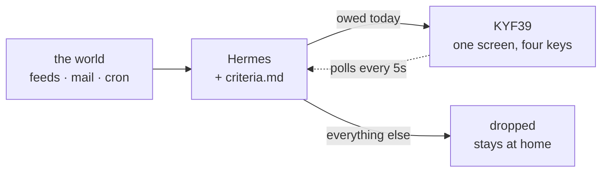

# vipa

**vipa** is *vipassanā*, cut short. A flip phone that carries nothing, and an agent at home
that decides what may reach it.

## Why

Almost everything that reaches a phone is story: what a crowd finds interesting, what a
screen wants you to compare, what a number says about your standing. None of it is
sensation. All of it is a demand.

vipa blocks the dynamics that collective fictions generate — rank, comparison, consensus
pressure, the race for standing — without arguing with them. What is left is what a life
actually owes to society: a deadline, a person waiting for an answer, a commitment, a change
that alters today's plan. That, and nothing else.

It is for real sensation, plain ethics, peace and stability. Not productivity, not
minimalism, not resistance — resistance stays in the same arena, and the point is to leave.

## How it works



One process, no second server: the plugin inside Hermes is the only door. The phone has no
push channel (no GMS), so it asks for new messages every five seconds.

## Two screens

The phone has two keys worth naming: **Reply** (top left) records, **Switch** (right) turns
the page.

- **the thread** — what the agent decided to send. Empty means empty: it says "No messages"
  and nothing else.
- **the day** — the routine from `hermes-plugin/vipa/schedule.json`: the item you are in,
  a NOW chip on it, a dot on the axis where the clock is, scrolling like the thread.

The same routine is part of the agent's instructions, so "what's next?" is answered from
the same list you are looking at. The agent is told it is not a schedule to manage.

## Requirements

- **Hermes** on a machine that stays on
- a **KYF39** flip phone — it can do very little, and its battery lasts about ten days
- a **Groq API key** — the phone has no usable keyboard, so voice is its only input
- **ngrok** — only to reach it from outside the house

## Install

Tell Hermes:

```
https://github.com/jumang4423/vipa — read README.md and INSTALL.md, then run install.sh to the end.
```

That is all. The agent installs the plugin, the platform config, the phone app and, if you
ask, the ngrok tunnel. Then it hands you one line, because the gateway has to restart and
Hermes refuses that from inside its own session:

```
cd ~/vipa && ./restart.sh
```

Two seconds later `/tmp/vipa-restart.txt` says `ok`. Nothing else is manual.

## How it decides

One question, and `hermes-plugin/vipa/criteria.md` is that question written out:

> Does this ask you to do something in the world today — or does it ask you to look at the
> phone?

If nothing is owed, nothing is sent. Silence is the default. The agent reads `philosophy.md`
and `criteria.md` as part of its instructions; edit them and restart, and the next session
carries the new rules.

## What the phone will never show

- a sentence cut in half — long answers are shown in full and scroll
- a count, a rank, a streak, a score
- a notice about itself

## Status

The door works. Enforcement is still the agent's judgement, not a mechanism: there is no
classifier and no audit log yet. See [INSTALL.md](INSTALL.md) for endpoints, settings and
troubleshooting.
